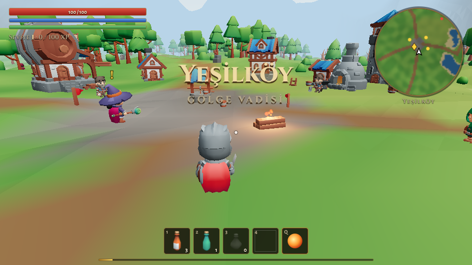

# Gölge Vadisi

Tarayıcıda çalışan, 3. şahıs kameralı bir aksiyon RPG.
Three.js 0.170 · TypeScript · Vite. Bütün modeller, sesler ve müzikler CC0.



Yeşilköy'ün yaşlı bilgesi Ozan, vadide ölülerin kalktığını söylüyor.
Doğu tarlasında iskeletler dolaşıyor, kuzey ormanındaki kampta çalınan bir
tılsım var. Kuzeydoğudaki harabelerde de hepsini kaldıran Kemik Lordu
uyanmış.

## Çalıştırma

```bash
cd Rpg3D
npm install
npm run dev          # http://127.0.0.1:5173
```

Derleyip statik olarak servis etmek için:

```bash
npm run build        # dist/ (tsc + vite)
npm run preview      # http://127.0.0.1:4173
```

Assetler (`public/assets/`) depoya commit'li. İnternetten yeniden indirmek
için `npm run assets` kullanılır (aşağıya bakın).

## Kontroller

| Tuş | Eylem |
|---|---|
| WASD | hareket (kameraya göre) |
| Fare | kamera (oyun alanına tıklayınca fare kilitlenir) |
| Tekerlek | yakınlaş / uzaklaş |
| Shift | koş (dayanıklılık harcar) |
| Space | zıpla |
| C / Sol Ctrl | yuvarlan (kısa yenilmezlik penceresi) |
| Sol tık | saldırı, 3'lü kombo (zamanında tekrar bas) |
| Sağ tık (basılı) | blok (yalnızca önden gelen vuruşa) |
| Q | ateş topu (18 mana, alan hasarı) |
| 1–4 | hotbar'daki iksirler |
| E / F | konuş, sandık aç |
| I / Tab | envanter |
| J / L | görev günlüğü |
| Esc / P | duraklat (panel açıksa paneli kapatır) |

Diyalogda seçenekler 1/2/3 tuşlarıyla seçilir. Envanterde tıklamak eşyayı
kuşanır ya da kullanır; sağ tık tüketilebilir eşyayı hotbar'a atar.

## İçerik

**Bölgeler**
- **Yeşilköy:** güvenli bölge, can hızla yenilenir.
- **Ayna Gölü**
- **Doğu tarlası**
- **Kuzey ormanı:** iskelet kampı.
- **Güney çayırı**
- **Kemik Harabeleri:** boss burada.

**Düşmanlar**

| Düşman | Davranış |
|---|---|
| İskelet Er | Bazıları yerde ölü taklidi yapar, yaklaşınca kalkar. |
| İskelet Haydut | Hızlı, hançerli. |
| İskelet Savaşçı | Kalkanlı ve zırhlı. |
| İskelet Büyücü | Mesafe korur, büyü oku atar. |
| Kemik Lordu (boss) | Ağır balta. Her üçüncü saldırısı 360° dönme. Canı yarıya inince iki iskelet çağırır, sendelemez. |

**Görev zinciri** (Bilge Ozan)
1. *Huzursuz Kemikler:* 5 iskelet yok et.
2. *Kayıp Tılsım:* kuzey kampındaki sandıktan tılsımı getir.
3. *Kemik Lordu:* harabelerdeki boss'u yen.

**RPG sistemleri**
- **Seviye:** 20 seviye. Her seviye can, mana, dayanıklılık, hasar ve büyü gücü verir.
- **Ekipman:** 3 yuva (silah, kalkan, yüzük). Silah ve kalkan karakterin elinde görünür. İki elli silah taşırken kalkan takılamaz.
- **Envanter:** 24 yuva, yığınlanabilir eşyalar.
- **Ganimet:** ağırlıklı ganimet tabloları ve nadirlik renkleri. Altın, karakter yaklaşınca kendiliğinden toplanır.
- **Tüccar:** alışveriş yapılabilir.
- **Ölüm:** köyde yeniden doğulur, altının %10'u kaybedilir.
- **Kayıt:** otomatik olarak dakikada bir ve görev teslimlerinde, elle duraklatma menüsünden. Tarayıcının localStorage'ına yazılır.

**Dünya**
- 12 dakikalık gündüz/gece döngüsü.
- Bölgeye göre müzik; savaşta ve boss karşısında müzik değişir.
- 3D konumlu efektler.
- Zemine göre değişen ayak sesleri (çim, toprak, taş, ahşap).
- Kamp ateşi, nehir ve rüzgâr gibi ortam sesleri.

## Doğrulama

```bash
npm run typecheck      # tsc --noEmit, 0 hata
npm test               # vitest: 33 birim testi
npm run verify:assets  # 942 kontrol: manifest<->disk, lisans, klipler, kemikler, ses
npm run build && npm run smoke   # uçtan uca: 55 kontrol + ekran görüntüleri
```

**Birim testleri** (`tests/`) şunları kapsar:
- seviye eğrisi ve XP devri,
- hasar, zırh, kritik ve blok hesabı, vuruş yayı,
- envanter yığınlama, kuşanma kuralları ve kayıt gidiş-dönüşü,
- görev zinciri ve toplama görevleri,
- veri bütünlüğü: her görev ödülü, dükkân ve ganimet eşyası tanımlı mı,
- yapay zekâ geçişleri,
- çarpışma (döndürülmüş kutu dahil),
- arazi: fizik yüksekliği mesh ile birebir mi, kamplar ve yollar kuru mu.

**Asset doğrulayıcı** (`tools/verify-assets.mjs`) oyunu açmadan çalışır:
- Kodda ve veride geçen her animasyon klibi adını toplar ve `anims.glb`'de arar.
- Bu kliplerin hedeflediği her kemiğin her karakterde bulunduğunu denetler.

Eksik kemik ne derlemede ne yüklemede hata verir: three.js o izi sessizce
atlar ve karakter yarım oynar. Bu yüzden bu kontrol ayrıca yapılıyor.

**Smoke test** (`tools/smoke.mjs`) derlenmiş oyunu headless Chromium'da
açar ve oyunu gerçek klavye ve fare olaylarıyla sürer:
- menü, ses kilidinin açılması ve müzik,
- yürüme ve koşma (klip ve ayak sesi dahil), zıplama, kılıç kombosu, ateş topu, yuvarlanma,
- NPC ile konuşma ve görev kabulü,
- yerden kalkan iskeletler, düşmanın oyuncuya vurması ve oyuncunun düşmana vurması,
- XP ve ganimet,
- envanter, görev teslimi,
- kaydet → sayfayı yeniden yükle → devam et,
- tılsım sandığı, tüccardan alışveriş,
- ölüm ve yeniden doğma,
- boss'un uyanması, boss barı ve boss müziği.

Ekran görüntüleri `capture/` klasörüne yazılır.

Smoke test yazılım GPU'sunda (SwiftShader) çalışıyor; bu sahne orada
saniyede 1–3 kare çiziliyor. Bu yüzden test `?quality=low&shadows=0&maxdt=0.25`
ile açılıyor ve sabit süre beklemek yerine koşulları yokluyor. Gerçek bir
ekran kartında bu ayarlara gerek yok.

## Assetler

Hepsi `tools/fetch-assets.mjs` ile indirildi. Kaynaklar commit SHA'sına
sabitlendiği için betik her seferinde aynı baytları üretir. Dosya bazında
kaynak ve lisans listesi `public/assets/CREDITS.md`'de.

| Paket | Yazar | Kullanım |
|---|---|---|
| KayKit Adventurers / Skeletons | Kay Lousberg | karakterler, silahlar, 46 animasyon |
| KayKit Medieval Hexagon | Kay Lousberg | köy binaları, eşyalar |
| KayKit Dungeon Remastered | Kay Lousberg | harabe, sandık, iksir şişeleri |
| KayKit Forest Nature | Kay Lousberg | ağaç, çalı, kaya, çimen |
| Kenney RPG Audio, Foley, Impact, Interface | Kenney | ayak sesi, kılıç, vuruş, arayüz |
| Ninja Adventure | Pixel-boy & AAA | müzik, büyü ve ortam sesleri, jingle'lar |

Betik şunları yapar:
- KayKit modellerini resmî GitHub depolarından indirir.
- Sesleri `series-ai/jam-ready-assets` aynasından indirir. Bu depo Git LFS kullanıyor; her dosya indirildikten sonra LFS işaretçisindeki sha256 ve boyutla doğrulanır.
- Karakterlerden kullanılmayan animasyonları atar. Kalan 46 klip ortak bir `anims.glb`'de tutulur, çünkü iki karakter paketi aynı iskeleti kullanıyor.
- IK/kontrol düğümü kanallarını ve sabit kanalları ayıklar. Karakter başına boyut 3.6 MB'dan yaklaşık 300 KB'a iner.
- Sesleri Ogg Vorbis'e çevirir; efektler mono, müzik -18 LUFS'a normalize.
- Toplam: 195 dosya, 12.2 MB.

> Neden kenney.nl değil de GitHub aynası? Bu depo bulut oturumunda
> geliştirildi. Oturumun ağ politikası `kenney.nl` ve `opengameart.org`
> adreslerini engelliyordu, GitHub ise açıktı. Paketler ve lisans
> dosyaları aynı.

## Mimari

```
src/
  core/      Game (döngü, modlar, etkileşim, görev/diyalog akışı), Input, Assets, Save, EventBus
  world/     Terrain (yükseklik haritası), Layout (bölgeler, kamplar, yollar), World,
             StaticBatcher, Sky (gündüz/gece), Particles, Colliders
  entities/  Character (model + AnimationMixer), Player, Enemy, EnemyAI (saf durum makinesi),
             Npc, Projectile, Loot, ThirdPersonCamera
  rpg/       Stats, Combat, Inventory, Items, Quests, Loot (hepsi saf mantık, test edilebilir)
  audio/     AudioManager (efekt/müzik/arayüz kanalları, 3D ses havuzu, müzik crossfade)
  ui/        Hud, Panels (envanter, görev, diyalog, dükkân, menüler), Icons (3D modelden ikon)
  data/      items, enemies, loot, quests, dialog, shop (JSON)
  i18n/tr.ts arayüz metinleri
```

Önemli kararlar:

- **Fizik motoru yok.**
  - Zemin bir yükseklik haritası. `heightAt` ızgaranın üçgenlerini enterpole eder, analitik fonksiyonu değil. Aksi halde eğimde ayaklar 0.5 birime kadar zemine gömülüyordu.
  - Engeller XZ düzleminde daire ve döndürülmüş kutu olarak tutulur, spatial hash ile aranır.
- **Statik birleştirme** (`StaticBatcher`).
  - Her KayKit paketi tek doku atlası kullanıyor. Aynı atlastaki statik nesneler 64×64'lük parça başına tek mesh'te birleştiriliyor.
  - Karakterlerin 6–9 parçalı gövdesi de tek SkinnedMesh'e birleşiyor.
  - Köyden bakınca draw call sayısı 441'den 66 (düşük kalite) ile 93 (orta/yüksek) arasına indi.
- **Parça (chunk) eleme.** Her parçanın kendi sınır küresi var; kamera ve gölge kamerası uzaktakileri eler. Tek bir dev instanced mesh, sınır küresi bütün dünya olduğu için hiç elenmiyordu (ölçüldü: 850 bin üçgen).
- **Uzaktaki düşmanlar uyur.** 110 birimden uzaktakiler ne güncellenir ne çizilir.
- **Mermi ışıkları havuzdan gelir.** Sahneye yeni PointLight eklemek bütün materyalleri yeniden derletir ve takılma yapar.
- **Yapay zekâ saf bir fonksiyon** (`nextState`). Animasyon ve hareket `Enemy`'de, karar mantığı tarayıcısız test edilebiliyor.

## Ayarlar ve URL parametreleri

**Ayarlar menüsü:**
- ana ses, müzik ve efekt seviyesi,
- fare hassasiyeti, Y eksenini ters çevirme,
- grafik kalitesi: düşük / orta / yüksek. Düşük kalite çimeni kapatır, az poligonlu ağaçlar kullanır ve görüş mesafesini kısaltır.

Ayarlar localStorage'a yazılır.

**Geliştirme için URL parametreleri:**
- `?quality=low|medium|high`
- `?shadows=0`
- `?scale=0.5`: piksel oranı
- `?maxdt=0.25`: kare başına en fazla oyun zamanı; düşük FPS'te oyunun ağır çekime düşmemesi için.

Konsoldan erişim: `window.__game`. Smoke test bunu kullanır: oyuncu durumu,
düşmanlar, görevler, ses istatistikleri, `perf()` ve ışınlanma.

## Bilinen boşluklar

- **Gamepad ve dokunmatik kontrol yok;** klavye ve fare gerekli.
- **Yüzme yok.** Derin suya girilemez.
- **Tarayıcı desteği:** Ses dosyaları Ogg Vorbis. Chrome, Edge ve Firefox çalıyor. Safari'nin eski sürümleri Ogg çözemeyebilir.
- **Kayıt kapsamı:** Kayıt oyuncuyu, envanteri, görevleri, açılan sandıkları ve boss'un durumunu tutuyor. Öldürülen sıradan iskeletler kayda girmiyor; kamplar yeniden yükleyince dolu başlıyor (oyun içinde de 75 sn sonra yeniden doğuyorlar).
- **Gerçek GPU performansı ölçülmedi:** Bu ortamda yalnızca yazılım GPU'su vardı. Köyden bakınca kare başına yük:

  | Kalite | Draw call | Üçgen (gölge geçişi hariç) |
  |---|---|---|
  | Düşük | 66 | ~220 bin |
  | Orta | 93 | ~470 bin |
  | Yüksek | 93 | ~490 bin |

  Bu yük bir masaüstü ekran kartı için hafif; zayıf bir dizüstünde "Düşük" kaliteyi denemek gerekebilir.
